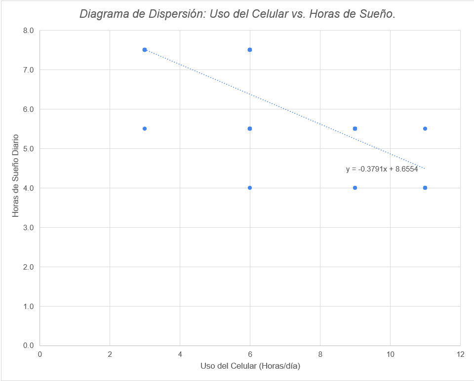
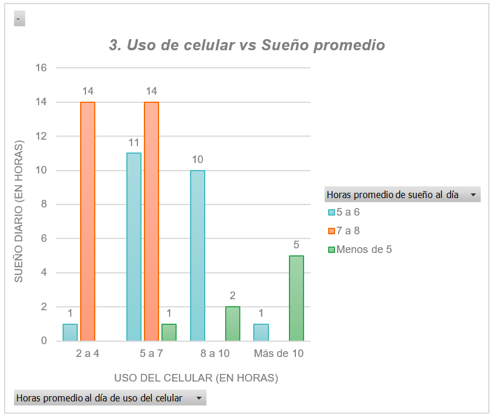
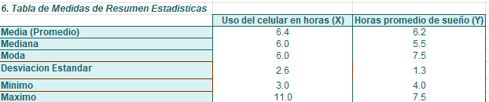

# Uso del celular y horas de sueño en estudiantes universitarios

Estudio estadístico para responder una pregunta concreta: **¿los estudiantes que usan más el celular duermen menos?**

Diseñé una encuesta, recolecté las respuestas de 59 estudiantes de la Institución Universitaria de Envigado (IUE) y analicé los datos en Excel con estadística descriptiva, tablas cruzadas y un modelo de regresión lineal simple.



---

## Fuente de datos

Datos primarios recolectados por mí mediante una encuesta en Google Forms (2026-2).

- **Participantes:** 59 estudiantes de pregrado de 12 carreras de la IUE (Ingeniería Industrial, Derecho, Ingeniería Informática, Psicología, Administración de Empresas, entre otras).
- **Muestreo:** por conveniencia; el enlace se difundió por grupos de mensajería.
- **Anonimato:** la participación fue voluntaria y el archivo no contiene nombres, correos ni datos de identificación.

**Variables (12):** carrera, semestre, rango de edad, género, horas de sueño, horas de uso del celular, uso principal del celular, frecuencia de actividad física, horas de estudio o trabajo, satisfacción con la vida (1–10), nivel de estrés y percepción de si el celular afecta el sueño.

## Herramientas

- **Google Forms:** diseño y aplicación de la encuesta
- **Excel:** tablas dinámicas, fórmulas estadísticas (`AVERAGE`, `STDEV`, `CORREL`, etc.), gráficos y regresión lineal

## Estructura del repositorio

```
uso-celular-sueno-estudiantes/
├── README.md
├── data/
│   └── Encuesta Calidad de Vida (respuestas).xlsx   # respuestas y análisis completo
├── informe/
│   └── Producto final - Estadistica.pdf            # documento entregado
└── img/                             # gráficos exportados
```

El archivo de Excel tiene tres hojas:

| Hoja | Contenido |
|---|---|
| 1. Recopilación Datos | Las 59 respuestas de la encuesta |
| 2. Análisis descriptivo | Tablas de frecuencia, tablas cruzadas y gráficos |
| 3. Análisis de regresión y corr. | Cálculo paso a paso de covarianza, correlación y recta de regresión |

## Qué hice

1. **Diseño de la encuesta** con 12 preguntas de opción múltiple y numéricas.
2. **Clasificación de variables** en cualitativas nominales, ordinales y cuantitativas.
3. **Organización de los datos** exportados de Google Forms a Excel.
4. **Análisis descriptivo:** tablas de frecuencia absoluta, relativa y acumulada; tablas cruzadas (uso del celular vs. sueño, género vs. edad, género vs. uso del celular) y medidas de resumen (media, mediana, moda, desviación estándar, coeficiente de variación).
5. **Regresión y correlación:** cálculo manual de la covarianza, el coeficiente de Pearson, el coeficiente de determinación y la recta de regresión, verificado con la línea de tendencia del gráfico.

## Resultados

**Descriptivos**
- Los estudiantes usan el celular en promedio **6,4 horas al día** (desviación estándar de 2,6 h).
- El **52,5 % duerme 6 horas o menos** y el 13,6 % menos de 5 horas.
- El **40,7 % reporta estrés alto o muy alto**.
- Todos los casos de uso extremo (más de 10 horas diarias) corresponden a hombres; las mujeres se concentran en el rango de 5 a 7 horas.

**Relación entre uso del celular y sueño**
- De quienes usan el celular entre 2 y 4 horas, **14 de 15 duermen de 7 a 8 horas**.
- De quienes lo usan más de 10 horas, **5 de 6 duermen menos de 5 horas**.

**Modelo de regresión lineal simple**

| Indicador | Valor |
|---|---|
| Correlación de Pearson (r) | −0,76 |
| Coeficiente de determinación (R²) | 0,57 |
| Recta de regresión | Sueño = 8,66 − 0,38 × Uso del celular |

Existe una **correlación negativa fuerte**: por cada hora adicional de celular, el sueño disminuye en promedio unos **23 minutos**. El modelo explica el 57 % de la variación en las horas de sueño.

## Capturas

| Uso del celular vs. sueño | Medidas de resumen |
|---|---|
|  |  |

## Cómo abrirlo

- **Sin instalar nada:** abre `informe/informe_final.pdf` directamente en GitHub.
- **Para ver los cálculos:** descarga `data/encuesta_calidad_vida.xlsx` y ábrelo en Excel o Google Sheets. Las fórmulas están visibles en la hoja 3.

## Limitaciones

- **Muestra pequeña y por conveniencia:** los resultados describen a los participantes, pero no se pueden generalizar a toda la universidad.
- **Datos en rangos:** las horas se preguntaron por intervalos (ej. "5 a 7") y para la regresión se usó el punto medio de cada uno. Por eso el diagrama de dispersión muestra pocos puntos superpuestos; preguntar el valor exacto daría un modelo más preciso.
- **Correlación no implica causalidad:** el estudio muestra que ambas variables se mueven juntas, no que el celular cause directamente la pérdida de sueño. Variables como el estrés o las horas de estudio podrían influir en ambas.


## Autora

**Valentina Cano Meneses** · [GitHub](https://github.com/srtaCano) · [LinkedIn](www.linkedin.com/in/valentina-cano-meneses)
